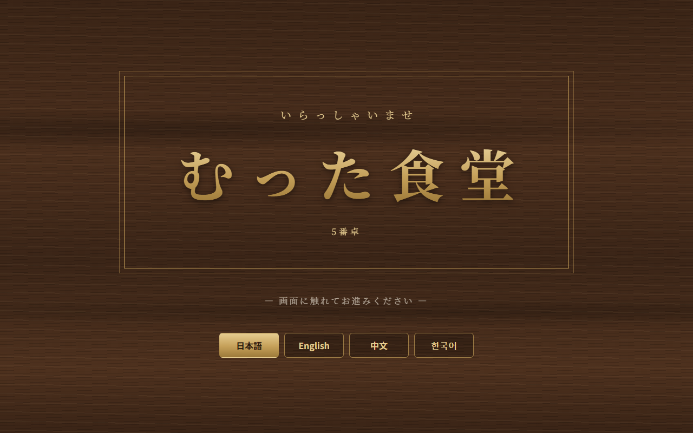
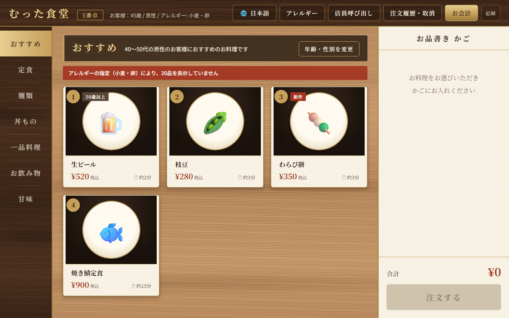
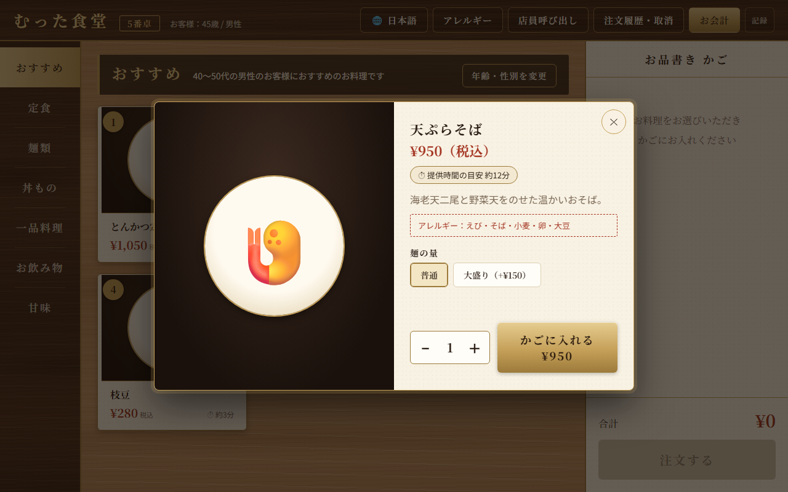
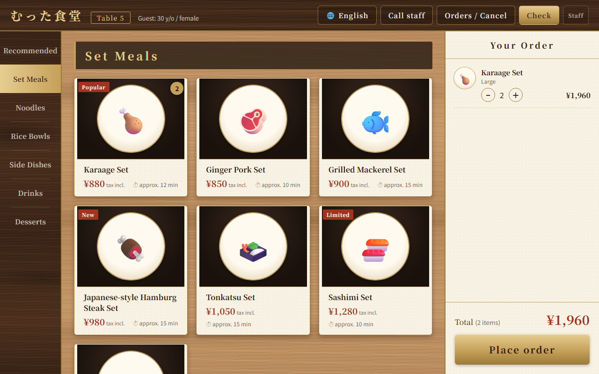

# むった食堂 テーブルオーダー

飲食店のテーブルに置いたタブレットで、お客様が自分で料理を選んで注文するための画面です。
HTML / CSS / JavaScript だけで作っているので、サーバーやインストールは必要ありません。



## 使い方

1. このリポジトリをダウンロードする（または `git clone https://github.com/mutta12/mutta1.git`）
2. `index.html` をブラウザ（Chrome / Edge など）で開く

タブレットでは、ブラウザを全画面表示にして横向きで使うのがおすすめです。

## 主な機能

### お客様向け

| 機能 | 内容 |
| --- | --- |
| 起動画面 | 店名「むった食堂」を表示。タップするか4秒で次へ進む |
| おすすめ | 年齢と性別を入れると、年代 × 性別に合わせたおすすめ料理を4品表示（スキップも可） |
| メニュー | 30品を7つのカテゴリ（おすすめ・定食・麺類・丼もの・一品料理・お飲み物・甘味）で切り替え |
| 注文 | 数量（1〜20）と、大盛り・サイズなどのオプションを選んで注文 |
| 提供時間の目安 | 料理ごとに「約12分」と表示。注文全体の目安と、できあがり時刻も表示 |
| 注文の取消 | お会計前なら、確定した注文も1品ずつ／注文ごとに取り消せる（2回押して確定） |
| お会計・割り勘 | 1〜20人で割り勘。1人分は1円未満を切り捨て、余りは幹事様の分に足す |
| 多言語 | 日本語・English・中文（简体字）・한국어。起動画面と上のバーで切り替え |
| アレルギー | 10品目（えび・かに・くるみ・小麦・そば・卵・乳・落花生・大豆・ごま）を指定すると、該当する料理をメニューとおすすめから除外 |
| その他 | 店員呼び出し、20歳未満のお客様はお酒を注文できない、品切れ表示 |







### お店向け

- 画面右上の「記録」ボタンで、これまでの注文記録を見られます。
- 「CSVで書き出す」で、記録を CSV ファイル（Excel で開けます）として保存できます。
- 記録する内容：注文日時、テーブル番号、年齢・年代・性別、注文言語、アレルギー指定、商品名、オプション、数量、単価、金額、提供目安、状態（注文／取消／会計済）、取消日時、会計日時、割り勘人数
- 取り消した注文も「取消」として残り、お会計が終わっても記録は消えません。

## ファイル構成

```
index.html   画面の骨組み
style.css    デザイン（木目・和紙・金の質感は CSS で表現、画像は使っていません）
menu.js      店名・テーブル番号・メニュー・提供時間・アレルギー情報・おすすめの設定
i18n.js      英語・中国語・韓国語の翻訳
app.js       画面の動き
CLAUDE.md    開発用のメモ（要件の一覧など）
```

## カスタマイズ

| 変えたいもの | 編集する場所 |
| --- | --- |
| 店名・テーブル番号 | `menu.js` の `STORE_NAME` / `TABLE_NUMBER` |
| 料理・値段・提供時間・品切れ | `menu.js` の `MENU_ITEMS`（`soldOut: true` で品切れ） |
| 料理のアレルギー情報 | `menu.js` の `ITEM_ALLERGENS` |
| おすすめの組み合わせ | `menu.js` の `RECOMMENDATIONS` |
| 料理名・説明の翻訳 | `i18n.js` の `ITEM_I18N` |
| ボタンや案内の文言 | `i18n.js` の `STRINGS` |

料理を追加したときは、`ITEM_ALLERGENS` と `ITEM_I18N` にも同じ番号で追加してください。

## 注意

- **アレルギー情報は、一般的な作り方をもとにした仮の内容です。** 実際のお店で使う前に、本当の材料と照らし合わせて必ず確認してください。
- 注文記録は、そのタブレットのブラウザの中（localStorage）にだけ保存されます。ブラウザのデータを消すと記録も消えるので、定期的に CSV で書き出してください。
- 注文はキッチンには送られません。キッチン画面と連携するには、サーバーの追加が必要です。
- 翻訳は AI（Claude）で作成したものです。お客様に出す前に、それぞれの言語が分かる人に確認してもらうと安心です。
- 明朝体などの書体は Google Fonts から読み込みます。インターネットにつながっていないときは、端末に入っている書体で表示されます。
